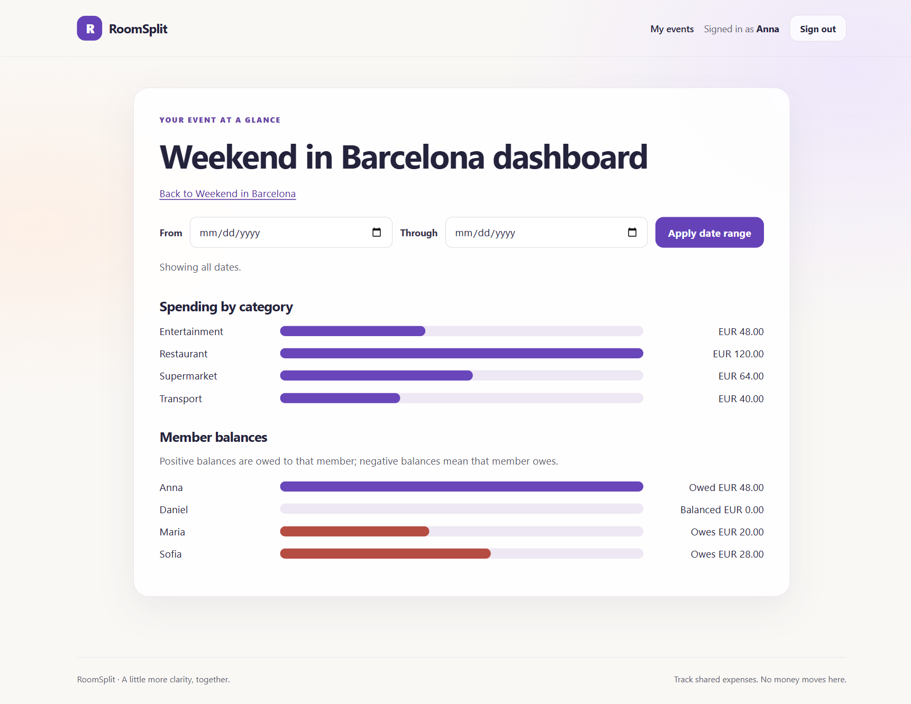
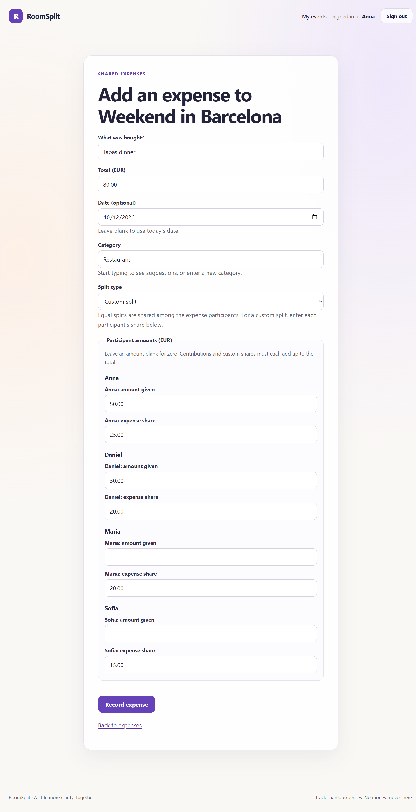

# RoomSplit: AI-Assisted Development

## 1. Project idea and requirements

RoomSplit is a local web application for groups who want to record shared
expenses and understand their balances. For example, friends can create an
event for a trip, record who paid for dinner and activities, and see how
repayments affect each member's balance.

The application supports:

- Username and password accounts and password-protected events. A member can
  join with an event hashcode and password or an invite link and password.
- Event owners, an appointed administrator, and server-side membership and
  record permissions. The administrator can manage any expense or repayment;
  other members can manage records they created.
- Expenses in EUR with categories, optional dates, multiple payers, and equal
  or custom splits. Custom shares and contributions must add up to the total.
- Repayments that update balances, and a dashboard with category spending,
  member balances, and date-range filters.

This is a local demonstration, not a payment system: it does **not** transfer
money. Data is held in memory only, so restarting the app clears accounts,
events, expenses, and repayments. Refunds and a database are outside the
current scope.

## 2. Architecture and technology

The app uses Python with Flask for routes and request handling, Jinja templates
for HTML, CSS and a little JavaScript for the interface, and Python's
`unittest` for testing. A runtime storage object holds accounts and event
records; it is not a database. The application is organized into the following
modules:

1. Application shell and runtime storage.
2. Accounts, events, and permissions.
3. Expenses, splits, and balances.
4. Repayments and dashboard.
5. Interface and testing.

**AI tool and model:** GitHub Copilot in VS Code was used throughout the
development workflow. The model was **Luna 6.0**, as reported by the project
author. Copilot was chosen to work interactively with the repository: it could
inspect existing files, propose and implement changes, and help run tests.

## 3. Development process by module

### 3.1. Application shell and runtime storage

**Approach and reasoning.** The app was deliberately kept small and local.
Flask's application factory creates a fresh in-memory storage boundary for each
runtime. A signed session identifies a user by ID; a session cannot resolve an
account after the runtime is restarted.

**Workflow.** I asked Copilot to implement the Flask/Jinja shell first, load the
session secret from a local `.env`, add `python-dotenv`, and avoid a database
or other persistence. Later modules reused the same storage boundary.

**Testing.** The early tests checked application creation, a basic response,
empty fresh storage, and a separate test secret. Acceptance tests also checked
that a fresh runtime does not recognize an old session.

**AI tool and model.** GitHub Copilot in VS Code, Luna 6.0 extra high in planning phase and medium in the rest. It helped establish
a small working foundation before the business features were added.

### 3.2. Accounts, events, and permissions

**Approach and reasoning.** Membership must be checked on the server rather
than relying on which buttons the interface displays. Passwords are stored as
hashes. The event creator is the owner and can appoint a current member,
including themselves, as administrator.

**Workflow.** I asked Copilot to implement registration and sign-in, event
creation, password-protected joining, membership, and roles. I later clarified
that administrators may edit or delete all expenses and repayments, while other
members may manage only their own records. Copilot updated both the routes and
the visible actions.

**Testing.** Tests cover registration, joining, appointment, nonmember access,
administrator actions, record ownership, and creator labels.

**AI tool and model.** GitHub Copilot in VS Code, Luna 6.0. It helped trace
permissions through the routes, templates, and tests.

### 3.3. Expenses, splits, and balances

**Approach and reasoning.** Monetary values use `Decimal` and cent precision.
An expense stores the members participating when it is recorded, so later
membership changes do not silently change its split. Payer contributions and
custom shares must each reconcile with the total.

**Workflow.** I asked Copilot to add expense entry, categories, multiple payers,
and balance calculations. After an equal-only version, I requested a choice
between equal and custom splits. For an equal split, any remainder is assigned
to the largest payer; the recorder chooses when the largest contributions tie.
Expense editing and deletion were then added.

**Testing.** Focused tests cover invalid amounts, custom and equal shares,
rounding, payer totals, participant snapshots, and authorization. Balance
checks verify that shares and contributions reconcile.

**AI tool and model.** GitHub Copilot in VS Code, Luna 6.0. It helped implement
and test the calculation rules without using binary floating-point money.

### 3.4. Repayments and dashboard

**Approach and reasoning.** A repayment records an actual payment outside the
app and adjusts the payer's and recipient's positions; RoomSplit itself does
not move money. The dashboard reuses the balance calculation and filters
expense and repayment activity by date.

**Workflow.** I asked Copilot to add repayment entry and validate repayment
limits. I later requested removal of refunds. The dashboard was built to show
category spending and member balances; a separate balance page reuses the
same calculation. Expense changes that would invalidate an existing repayment
are rejected.

**Testing.** Tests check overpayment rejection, repayment history, date
boundaries, category totals, permissions, and empty states. One regression test
checks that a EUR 10 repayment settles a EUR 10 debt.

**AI tool and model.** GitHub Copilot in VS Code, Luna 6.0. It helped connect
repayment records to the existing calculation instead of duplicating money
logic in the dashboard.

### 3.5. Interface and testing

**Approach and reasoning.** I wanted the local demo to be readable and easy to
navigate. The interface uses responsive layouts, labelled forms, and separate
pages for members, expenses, repayments, and balances.

**Workflow.** I asked Copilot to redesign the layout and buttons, rename
user-facing rooms to events, add category suggestions, and reorganize the
event pages. It adjusted the Jinja templates, CSS, and small JavaScript helpers.

**Testing.** The project uses a test-first workflow: add focused checks,
implement the behavior, and run regression tests. Browser checks covered
desktop and mobile layouts and a synthetic five-member event. A recorded full
run of `python -B -m unittest discover -s tests` passed 73 tests; subsequent
focused permission tests also passed.

**AI tool and model.** GitHub Copilot in VS Code, Luna 6.0. It helped iterate on
the presentation while preserving the existing Flask/Jinja architecture.

## 4. Key prompts and interactions

The following are examples from the development conversation:

1. “Use `Decimal` for monetary values and reject invalid or more-than-two-decimal amounts.”
2. “Remove Refunds from the app totally. Make Repayment to transfer amounts from one member to another. This is to be calculated in the member balances.”
3. “Please make expenses to have a choice between two - equal split and custom split.”

The second request describes recording a repayment: the implemented app updates
balances but does not execute a transfer. For ambiguous permissions and for
expense changes that would invalidate an existing repayment, Copilot asked for
clarification before applying the selected rules.

## 5. Challenges and tool comparison

- **Money and rounding:** equal splits, custom shares, multiple payers, and
  repayments must reconcile to cents. Explicit rules and focused tests were
  needed to avoid incorrect balances. A lot of questions were asked by the AI Agent
  in order to verify the right setting.
- **Permissions and changing requirements:** the permission rules and the
  interface evolved during development. Server-side checks and tests had to
  change together with the visible controls.
- **Runtime-only data and old servers:** restarting erases data, while an older
  server process can continue serving an older version. Checking the listening
  port and process helped distinguish those cases. It took quite some time to realize that
  older processes should be killed and then a fresh run of the server to be made.

GitHub Copilot was the tool used in the documented workflow and was most useful
for iterating across code, tests, and documentation in the same project.
No direct comparison with Claude Code, Augment Code, or Cursor was performed,
so no comparative performance claim is made.

If development continued, useful next steps would be to design a persistent
database, address deployment and security requirements, and expand end-to-end
browser testing. Those are future improvements, not features of this demo.

## 6. Working system evidence

The screenshots below were captured from the running app with synthetic users
and example amounts. No actual payment was made.

**Figure 1. Dashboard showing category spending and member balances.**

**Figure 2. Expense entry with custom split and participant fields.**

## 7. Running and testing locally

1. Install the dependencies with `python -m pip install -r requirements.txt`.
2. If `.env` does not already exist, copy `.env.example` to `.env`. Replace
   the placeholder with a unique local `ROOMSPLIT_SECRET_KEY`; do not commit it.
3. Run `python app.py` and open <http://127.0.0.1:5000/>.
4. Run the automated tests with `python -B -m unittest discover -s tests`.

The Flask development server is intended for local development, not production.

## 8. Repository and submission

Repository: <https://github.com/lpkotsev/RoomSplit>

Verify that the repository is publicly accessible before submitting.
